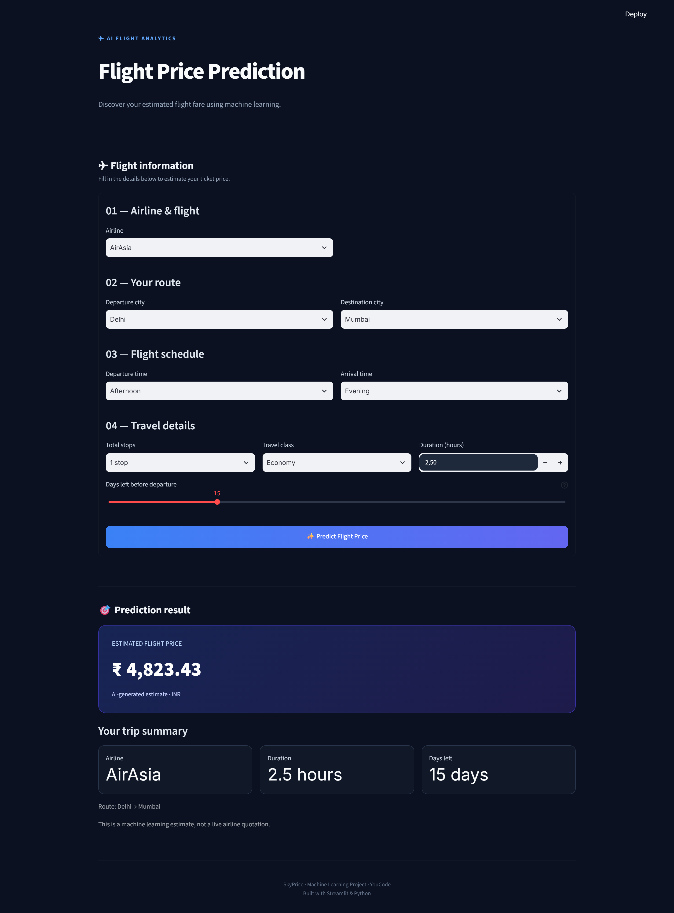
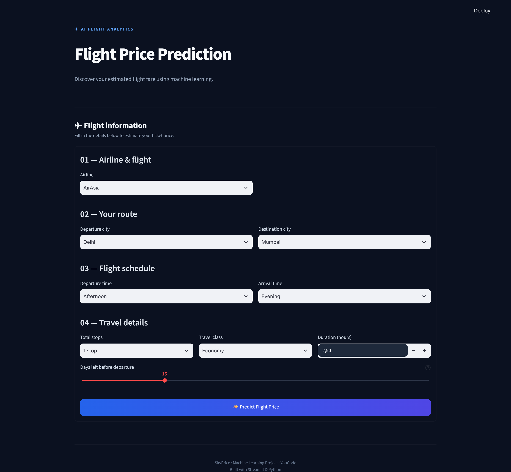
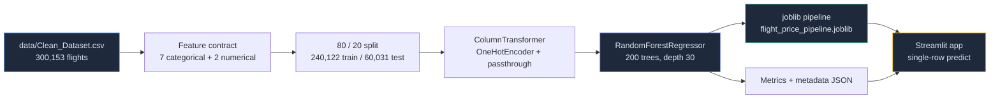
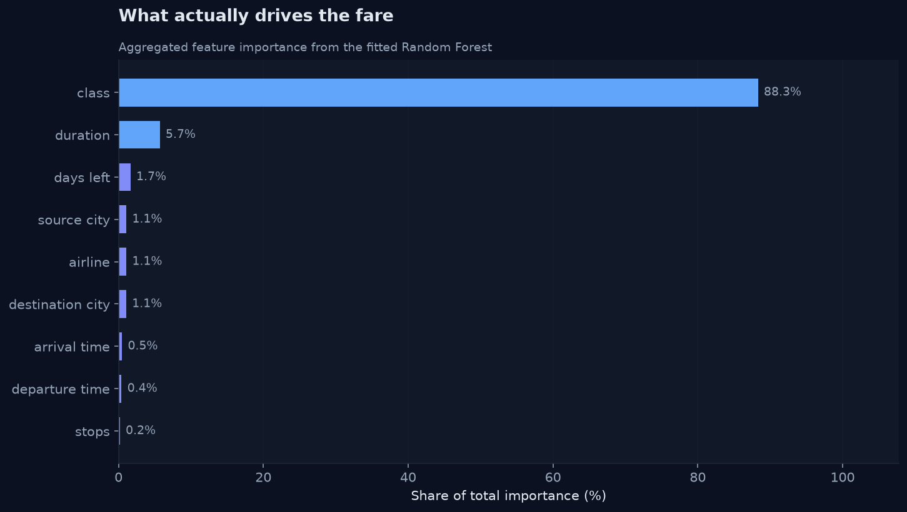
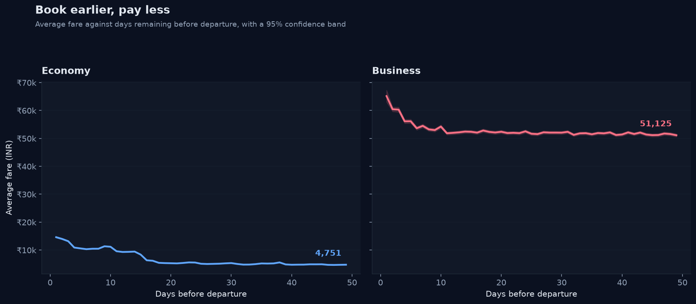
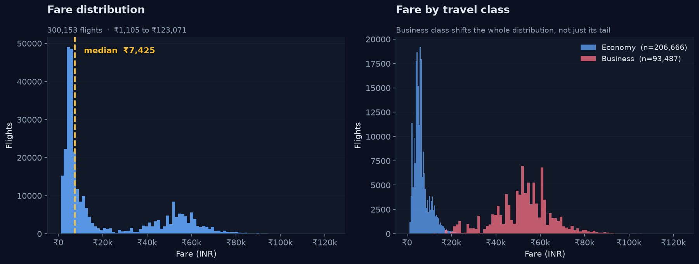
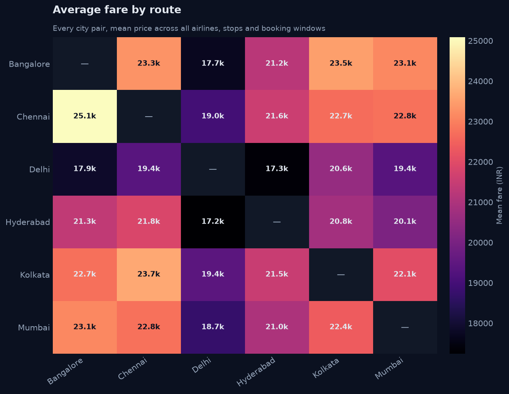

<div align="center">

# ✈️ SkyPrice

### Predicting domestic flight fares with Machine Learning

**300,153 flights · 9 features · Random Forest · R² 0.985**

[](https://www.python.org/)
[](https://streamlit.io/)
[](https://scikit-learn.org/)
[](https://pandas.pydata.org/)
[](https://scikit-learn.org/stable/modules/model_evaluation.html#r2-score)
[](https://scikit-learn.org/stable/modules/model_evaluation.html#mean-absolute-error)
[](LICENSE)

[🚀 Live demo](#-the-app) · [⚡ Quick start](#-quick-start) · [📊 Results](#-results) · [🧠 Model card](#-model-card) · [📁 Structure](#-project-structure)

</div>

---

## 💡 What this is

A complete, reproducible machine-learning project that answers a very human question:

> **"Should I book this flight now, or wait?"**

It takes a route, an airline, a departure slot, a cabin class and a booking window, and returns an
estimated fare in INR — backed by a `RandomForestRegressor` trained on **300,153 real domestic
flights** across six Indian carriers and six metros.

Everything is local, reproducible and inspectable: the dataset, the training script, the notebook,
the figures, and a dark-themed Streamlit app that runs the trained pipeline end to end.

> **This is an educational project, not a commercial fare quote.** The numbers come from a
> historical Kaggle dataset. Do not use it as a booking price.

---

## 🚀 The app

<div align="center">



</div>

A dark, single-page interface built with Streamlit. Nine inputs, one button, one estimate — with a
trip summary underneath and an explicit note that the figure is a model estimate, not a quotation.

<div align="center">

</div>

---

## ⚡ Quick start

```bash
git clone https://github.com/ilyasaitbel/flight-price-ml.git
cd flight-price-ml

python -m venv .venv
source .venv/bin/activate        # Windows: .venv\Scripts\activate

pip install -r requirements.txt
```

### 1 — Train the model

The trained pipeline is **~1 GB**, far above GitHub's 100 MB per-file limit, so it is not committed.
Regenerate it locally (about four minutes on a laptop):

```bash
python scripts/train_model.py
```

This writes two files to `artifacts/`:

| File | Purpose |
| :--- | :--- |
| `flight_price_pipeline.joblib` | the fitted `Pipeline` — preprocessing **and** model in one object |
| `flight_price_model.meta.json` | the feature contract, category lists and evaluation metrics |

### 2 — Run the app

```bash
streamlit run app/app.py
```

Open [http://localhost:8501](http://localhost:8501) and drop in a trip.

### 3 — (Optional) Regenerate the figures

```bash
python scripts/generate_charts.py
```

---

## 🏗️ How it works



The important design decision is that **preprocessing lives inside the pipeline**. The saved
`.joblib` contains the `OneHotEncoder` together with the forest, so the app only has to build a
one-row DataFrame with the right column names and call `predict()`. There is no second place where
the two can drift apart.

The app reads the feature order from `flight_price_model.meta.json` rather than hard-coding it, so
retraining with a different feature set does not require editing the UI.

---

## 📊 Results

Evaluated once on a held-out test set of **60,031 flights** that never took part in training.

| Metric | Value | Reading |
| :--- | ---: | :--- |
| **MAE** | ₹1,299.07 | typical error ≈ ₹1,300 |
| **MAE 95% CI** | ₹1,279.52 – ₹1,318.93 | percentile bootstrap, 200 resamples |
| **RMSE** | ₹2,804.51 | penalises the large misses |
| **R²** | **0.9847** | explains 98.5% of the fare variance |

<div align="center">

</div>

**The headline finding is blunt: the travel class carries 88% of the signal.** Duration adds 5.7%,
and the booking window 1.7%. Route, airline and time of day barely register on their own — a
genuinely useful thing to learn about how airline pricing works.

| Feature | Type | Share of importance |
| :--- | :--- | ---: |
| `class` | categorical | **88.3%** |
| `duration` | numerical | 5.7% |
| `days_left` | numerical | 1.7% |
| `source_city` | categorical | 1.1% |
| `airline` | categorical | 1.1% |
| `destination_city` | categorical | 1.1% |
| `arrival_time` | categorical | 0.5% |
| `departure_time` | categorical | 0.4% |
| `stops` | categorical | 0.2% |

### Booking early is worth real money

<div align="center">

</div>

Across the dataset, average economy fares fall from **₹14,613 one day before departure to ₹4,751
seven weeks out** — a **67.5% drop**. Business fares fall from **₹65,169 to ₹51,125** over the same
window, a more modest **21.6%**.

---

## 📈 The data

`data/Clean_Dataset.csv` — 300,153 domestic flights, one row each.

| Property | Value |
| :--- | :--- |
| Rows | 300,153 |
| Airlines | 6 — AirAsia, Air India, Go First, IndiGo, SpiceJet, Vistara |
| Cities | 6 — Bangalore, Chennai, Delhi, Hyderabad, Kolkata, Mumbai |
| Routes | 30 directed city pairs |
| Distinct flight numbers | 1,561 |
| Fare range | ₹1,105 – ₹123,071 |
| Median / mean fare | ₹7,425 / ₹20,890 |
| Duration | 0.83 – 49.83 hours |
| Booking window | 1 – 49 days before departure |
| Cabin split | Economy 68.9% · Business 31.1% |
| Stops | 1 stop 83.6% · non-stop 12.0% · 2+ stops 4.4% |

<div align="center">





</div>

The fare distribution is strongly right-skewed, and business class does not just extend the tail —
it shifts the entire distribution. Mean fare varies by roughly **₹17,200 to ₹25,100** across the
30 routes, a spread of about **₹7,800**: all five cheapest corridors touch Delhi (Hyderabad–Delhi
at ₹17,244 is the cheapest of all), while Chennai–Bangalore is the dearest at ₹25,082.

---

## 🧠 Model card

### Feature contract

The nine columns the model consumes, exactly as they appear in `flight_price_model.meta.json`:

| Feature | Type | Range / values |
| :--- | :--- | :--- |
| `airline` | categorical | 6 carriers |
| `source_city` | categorical | 6 cities |
| `departure_time` | categorical | Morning, Early_Morning, Afternoon, Evening, Night, Late_Night |
| `stops` | categorical | `zero`, `one`, `two_or_more` |
| `arrival_time` | categorical | same six slots as `departure_time` |
| `destination_city` | categorical | 6 cities |
| `class` | categorical | `Economy`, `Business` |
| `duration` | numerical | hours, 0.83 – 49.83 |
| `days_left` | numerical | 1 – 49 |

### One column is deliberately left out

The raw dataset carries a `flight` column with **1,561 distinct flight numbers**. It is excluded on
purpose: one-hot encoding it would add 1,561 columns, and a model that memorises flight numbers
cannot say anything about a flight it has never seen. Every column that survives is one that could
in principle generalise to a new flight.

### Pipeline

| Stage | Choice | Why |
| :--- | :--- | :--- |
| Categorical | `OneHotEncoder(handle_unknown="ignore")` | unseen categories map to zeros instead of crashing the app |
| Numerical | `passthrough` | trees need no scaling |
| Estimator | `RandomForestRegressor(n_estimators=200, max_depth=30, min_samples_leaf=2)` | strong on tabular data, gives feature importances for free, no scaling needed |
| Split | 80 / 20, `random_state=42` | test set touched once, at evaluation time |

### Known limitations

- **Single historical dataset.** All flights come from one collection window of Indian domestic
  routes. The model says nothing about international routes, other seasons or today's fares.
- **No time split.** The split is random, not chronological, so the model is not explicitly tested
  against fare drift over time.
- **Fare ≠ price.** The target is the listed fare. Taxes, fees, baggage and the difference between
  the cheapest and the cheapest *available* seat are all outside the feature set.
- **Importance is not causation.** The 88% weight on `class` reflects correlation in this dataset,
  not a causal claim about how airlines price.
- **The heatmap-style visuals are charts of the data**, not model attribution — no SHAP or
  permutation analysis has been run.

---

## 📁 Project structure

```
flight-price-ml/
├── app/
│   └── app.py                             # Streamlit interface (dark theme, single form)
├── artifacts/
│   ├── flight_price_model.meta.json       # feature contract + metrics  (committed)
│   └── flight_price_pipeline.joblib       # fitted pipeline, ~1 GB       (not committed)
├── data/
│   └── Clean_Dataset.csv                  # 300,153 flights
├── docs/                                  # figures used by this README
│   ├── app_home.png
│   ├── app_prediction.png
│   ├── booking_curve.png
│   ├── feature_importance.png
│   ├── price_distribution.png
│   └── route_heatmap.png
├── notebooks/
│   └── flight_price_prediction.ipynb      # the full walkthrough, 11 sections
├── scripts/
│   ├── train_model.py                     # reproducible training + artifact export
│   ├── generate_charts.py                 # regenerates docs/ from data + model
│   └── capture_screenshots.py             # screenshots the running app
├── .gitignore
├── README.md
└── requirements.txt
```

---

## 🔬 Reproducibility

| | |
| :--- | :--- |
| Seed | `random_state=42` everywhere |
| Split | 240,122 train / 60,031 test |
| Metrics from `scripts/train_model.py` | MAE ₹1,092.03 · RMSE ₹2,693.82 · R² 0.9859 |
| Metrics committed in `artifacts/…meta.json` | MAE ₹1,299.07 · RMSE ₹2,804.51 · R² 0.9847 |

Both runs agree on the feature contract and land within ~1% of each other; the difference is tree
sampling and the train/test split used to produce the original artifact. The MAE confidence interval
is a percentile bootstrap over 200 resamples of the test errors, not a closed-form estimate.

---

## 🚧 Roadmap

- [x] Clean dataset + exploratory analysis
- [x] Random Forest pipeline with preprocessing baked in
- [x] Streamlit interface
- [x] Reproducible training script and notebook
- [x] Documented model card
- [ ] Gradient boosting comparison (LightGBM / XGBoost)
- [ ] SHAP values for genuine per-prediction attribution
- [ ] A proper temporal train/test split to measure drift
- [ ] Predicting fare *buckets* (cheap / typical / premium) alongside the point estimate
- [ ] GitHub Actions workflow to retrain and publish the model as a release asset

---

## 🤝 Contributing

Pull requests are welcome. If you touch the model, please keep these two files in sync:

- `artifacts/flight_price_model.meta.json` — the feature contract the app reads at runtime
- `app/app.py` — the `TIMES` list must match the dataset values exactly (`Early_Morning` and
  `Late_Night` use **underscores**; the fitted encoder was trained on those spellings)

---

## 📜 Credits & licence

- **Dataset** — Kaggle *Flight Price Prediction* (cleaned), 300,153 domestic Indian flights.
- **Model** — `RandomForestRegressor` from scikit-learn.
- **App** — Streamlit.
- **Licence** — MIT.

---

<div align="center">

**✈️ SkyPrice** · Machine Learning Project · YouCode
<br/>
Built with Streamlit & Python

</div>
